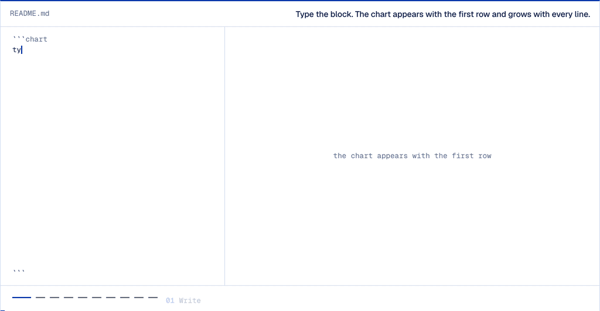

# Markvis: charts in Markdown

Draw charts in your notes from a short code block: a few header lines, then the numbers as CSV or a Markdown table. The chart draws in Reading view and Live Preview, in your theme's colors, with no network and no settings. The block stays plain text in the file, so it syncs, diffs, and still reads as a table in any other Markdown app; a block that cannot be drawn shows its rows as a table plus one line saying what to fix. This plugin is a thin host for [markvis](https://markvis.js.org), which defines the block and draws the SVG.



*The block and its chart, recorded from the live demo on markvis.js.org. In a note the chart draws in place of the block.*

## Write a chart

````markdown
```chart
markvis: 2
type: bar
title: Visits by day
x: day
y: visits

day,visits
Mon,120
Tue,180
Wed,150
Thu,210
Fri,190
```
````

The fence can be `chart`, `markvis`, or `vis`. If another plugin already handles `chart` fences, use `markvis` or `vis`. Seventeen chart types: `bar` `line` `area` `scatter` `pie` `hist` `heatmap` `funnel` `waterfall` `radar` `gauge` `sankey` `treemap` `dumbbell` `bullet` `boxplot` `calendar`. Leave out `title:` and the note's name is used. The block format, every type, and examples are at [markvis.js.org](https://markvis.js.org).

## Install

- **Community plugins** (once listed): Settings → Community plugins → Browse, search for "Markvis", install, enable.
- **Before the listing**: install the BRAT plugin, choose "Add beta plugin", enter `geekplux/markvis-obsidian`, then enable Markvis under Community plugins.
- **By hand**: download `main.js`, `manifest.json`, and `styles.css` from the latest [release](https://github.com/geekplux/markvis-obsidian/releases) into `<vault>/.obsidian/plugins/markvis/`, reload, and enable Markvis.

## Colors follow your theme

markvis paints its text, grid, background, and series colors as CSS variables with fixed fallbacks, and the plugin's `styles.css` points those variables at the colors every Obsidian theme defines (`--text-normal`, `--text-muted`, `--background-primary`, `--color-accent`, `--color-blue` and the other named colors). Switch between light and dark, or to another theme, and the chart follows without a redraw. To change a color, add a CSS snippet:

```css
.markvis {
  --markvis-series-1: #7c3aed; /* first series */
  --markvis-ink: var(--text-accent); /* titles and values */
}
```

The variables are `--markvis-ink`, `-muted`, `-grid`, `-paper`, `-plate`, `-plot`, `-accent`, `-series-1` to `-series-8`, `-up`, `-down`, and `-total`. Chart text keeps markvis's own font unless you opt in with `.markvis { --markvis-font: var(--font-text); }`.

Under each chart, a caption and the full data table come with the figure by design, so the numbers stay readable and searchable next to the picture.

## Manual checklist

Run before each release, in a vault with one note holding a valid block and a broken one (for example `type: donut`):

- [ ] **Reading view**: the valid block draws as a chart; the broken block shows its table and one error line.
- [ ] **Live Preview**: both blocks render when the cursor leaves them, and the chart redraws after a number is edited.
- [ ] **Default dark theme**: text, grid, and bars use the theme's colors; nothing is dark-on-dark.
- [ ] **PDF export**: the chart appears in the PDF at the note width.
- [ ] **Mobile**: the chart scales to the screen width with no horizontal scroll.

## Develop

```sh
npm install
npm test        # type-check, build main.js, run the tests
npm run dev     # rebuild main.js on change
```

Release: `npm version <patch|minor|major>` updates `manifest.json` and `versions.json`; push the tag (no `v` prefix) and the release workflow attaches `main.js`, `manifest.json`, and `styles.css`.

## License

MIT
